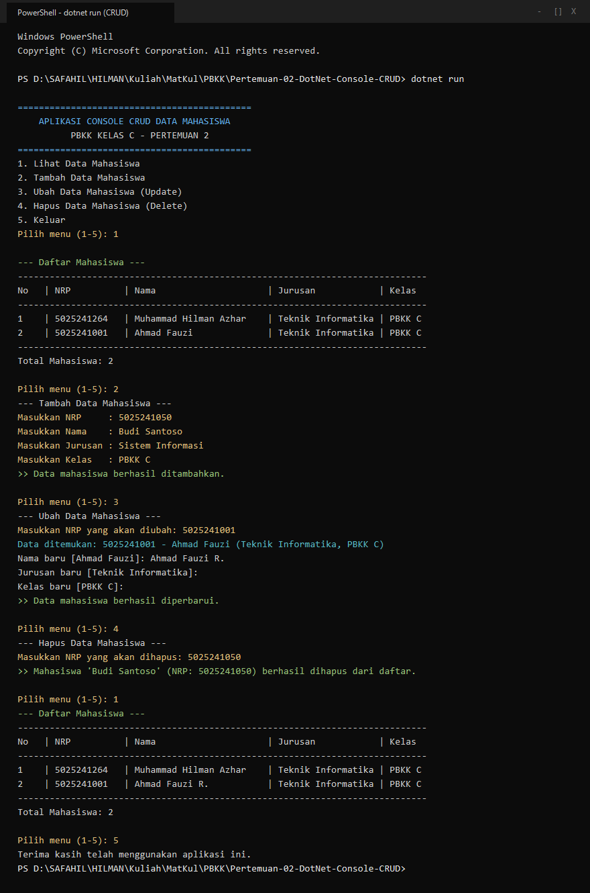

# Pertemuan 02: .NET Framework & Aplikasi Console CRUD

Implementasi aplikasi C# Console untuk operasi CRUD data mahasiswa di memori untuk tugas Pertemuan 02 mata kuliah Pemrograman Berbasis Kerangka Kerja (PBKK) C.

## Identitas
- **Nama:** Muhammad Hilman Azhar
- **NRP:** 5025241264
- **Kelas:** PBKK C
- **Dosen Pengampu:** Fajar Baskoro, S.Kom., M.T.
- **Laporan Notion:** [Buka Laporan di Notion](https://app.notion.com/p/Pertemuan-2-NET-Framework-Latihan-Aplikasi-Console-CRUD-4009c0720c5a8100b9cdd41f09ac70c7)

## Deskripsi Singkat
Aplikasi berbasis antarmuka console untuk memanipulasi data mahasiswa secara interaktif. Mendukung operasi:
1. **Lihat Data (Read):** Menampilkan tabel data mahasiswa tersimpan beserta total data.
2. **Tambah Data (Create):** Menambahkan data baru dengan validasi NRP unik.
3. **Ubah Data (Update):** Memperbarui nama, jurusan, atau kelas berdasarkan NRP (nilai kosong mempertahankan data lama).
4. **Hapus Data (Delete):** Menghapus data mahasiswa dari memori berdasarkan NRP.

## Struktur Berkas
- `Program.cs`: Berkas utama program C# dengan implementasi fungsi CRUD.
- `Pertemuan-02-DotNet-Console-CRUD.csproj`: Berkas konfigurasi proyek .NET 10.0 Console.
- `screenshots/terminal_crud.png`: Bukti tangkapan layar eksekusi seluruh siklus CRUD.

## Cara Menjalankan
Pastikan .NET SDK telah terinstal di komputer.

```bash
dotnet run
```

## Hasil Eksekusi
Tampilan output saat program dijalankan dan diuji melalui terminal:


